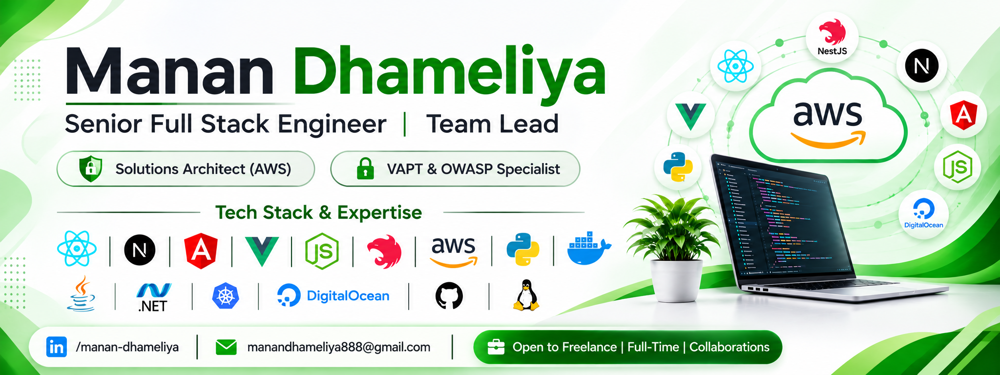

<div align="center">



# Manan Dhameliya

### Senior Full Stack Engineer · Team Lead · Solutions Architect (AWS) · VAPT & OWASP Specialist

[](https://www.linkedin.com/in/manan-dhameliya/)
[](mailto:manandhameliya888@gmail.com)
[](mailto:manandhameliya888@gmail.com)

</div>

---

## 👋 About Me

Seasoned **Senior Software Engineer and Team Leader** who builds, secures, and scales modern web platforms end to end. I bridge the gap between engineering and business — translating complex requirements into feasible, scalable architectures and leading high-performing teams to ship them.

- 🏗️ **Architecture** — Serverless & event-driven solutions on **AWS** (Serverless Framework), high-performance full stack systems across **MEAN / MERN**, **Next.js**, **NestJS** and **Go**
- 🔐 **Security** — **VAPT Fix Specialist**: identify, exploit and remediate **OWASP Top 10** vulnerabilities across web apps, APIs and infrastructure
- 👥 **Leadership** — Team Lead, Requirement Lead and Business Analyst with experience owning client relationships, B2B & vendor contracts, and staff augmentation
- 🤖 **AI‑Assisted Engineering** — Expert in AI coding tools and prompt engineering, paired with rigorous personal code review and thorough testing before anything ships
- 🧭 **Working style** — Agile (Scrum / Kanban), strategic performance optimization, and a relentless focus on project outcomes
- 💼 **Open to** — Freelance, Full‑Time Opportunities and Collaborations in **Frontend, Backend, Full Stack or Lead** roles

> 🌱 Actively seeking opportunities to learn and build with **Web3, LLMs, NLP, Generative AI and Blockchain**.

---

## 🧩 Core Competencies

| Engineering | Security | Cloud & Architecture | Business |
|---|---|---|---|
| Full Stack Development (JS/TS) | VAPT & OWASP Top 10 Remediation | AWS Solution Architecture | Requirement Analysis & Leadership |
| Third‑party Library & API Integration | Secure REST APIs, JWT & Session Mgmt | Serverless Framework | Business Analysis |
| Micro Frontends (Nx Monorepo) | Server Hardening | Scalable, High‑performance Systems | Client & Project Management |
| Framework Version Upgrades & Migrations | End‑to‑end Pen Testing | Cost‑efficient Cloud Design | B2B / Vendor Contracts & Staff Augmentation |

---

## 🛠️ Tech Stack

### Languages


### Frontend


### UI Frameworks


### Backend


### Databases & Search


### Cloud, DevOps & Tooling


### CMS, Commerce & Integrations


### Mobile


### Design (UI / UX)


---

## 🔐 Security & VAPT

**Vulnerability Assessment & Penetration Testing — Fix Specialist and Resolution Expert**

I don't just build applications, I make them production‑safe. I specialize in identifying, exploiting and remediating vulnerabilities so products meet modern security standards and compliance requirements.

**What a VAPT engagement covers**

- 🎯 Identify and fix critical vulnerabilities — **SQL Injection, XSS, CSRF, IDOR, Authentication Bypass**
- 🔑 Secure **REST APIs, JWT authentication and session management**
- 🧪 End‑to‑end penetration testing of web applications and backend systems
- 🛡️ Server hardening and improved overall security posture
- ✅ Clean, secure, scalable remediation delivered as production‑ready code

**Tool stack**


---

## 💳 Payment Integrations

End‑to‑end integration with global and regional payment providers, private banks and UPI rails.


---

## 🏢 Industry Experience

| Domain | Highlights |
|---|---|
| ☁️ **SaaS / PaaS / IaaS** | MVP to scale‑up platforms |
| 🤖 **AI Agents & Automation** | Agentic workflows and process automation |
| 🛒 **eCommerce** | Headless & custom storefronts, CMS‑driven commerce |
| 🏥 **Healthcare** | HIPAA‑aware systems, FHIR / HL7 interoperability |
| 🏋️ **Fitness** | Member, training and subscription platforms |
| ✈️ **Travel / Resort / Campsite** | Booking engines and inventory management |
| 🚗 **Automobile** | Dealer, inventory and service platforms |
| 🎓 **Education & E‑learning** | LMS and content delivery platforms |
| 🍽️ **Food & Restaurant** | Ordering, menu and delivery systems |
| 🏠 **Real Estate** | Listings, CRM and lead management |
| 🛡️ **Insurance** | Motor, Health and Travel policy platforms |
| 🏛️ **Enterprise / Legacy** | Modernization, upgrades and cloud migration |
| 🔗 **Networking & Social** | Connection and community platforms |
| 🎲 **Gaming & Betting** | Multi‑game betting platforms |

---

## 🧭 How I Work

```text
Discover  →  Analyse  →  Architect  →  Build  →  Secure  →  Ship  →  Optimize
```

- **Requirement Lead / Business Analyst** — turn ambiguous business goals into clear, actionable, scalable technical solutions
- **Team Leadership** — collaborative, outcome‑driven leadership that grows high‑performing engineering teams
- **Client Partnership** — hands‑on experience managing projects and relationships directly with clients, including B2B and long‑term vendor contracts
- **Quality First** — every line of code (human or AI‑assisted) is personally reviewed and thoroughly tested before it moves forward

---

## � Let's Connect

Open to **Freelance, Full‑Time Opportunities and Collaborations** in **Frontend, Backend, Full Stack or Lead** roles, as well as consulting engagements in **VAPT, AWS architecture and full stack delivery**.

- 📧 **Email**: [manandhameliya888@gmail.com](mailto:manandhameliya888@gmail.com)
- 💼 **LinkedIn**: [linkedin.com/in/manan-dhameliya](https://www.linkedin.com/in/manan-dhameliya/)

<div align="center">

*Building secure, scalable products — and the teams that deliver them.*

</div>


<!--
**manandhameliya888/manandhameliya888** is a ✨ _special_ ✨ repository because its `README.md` (this file) appears on your GitHub profile.

Here are some ideas to get you started:

- 🔭 I’m currently working on ...
- 🌱 I’m currently learning ...
- 👯 I’m looking to collaborate on ...
- 🤔 I’m looking for help with ...
- 💬 Ask me about ...
- 📫 How to reach me: ...
- 😄 Pronouns: ...
- ⚡ Fun fact: ...
-->
